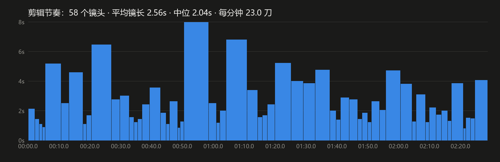
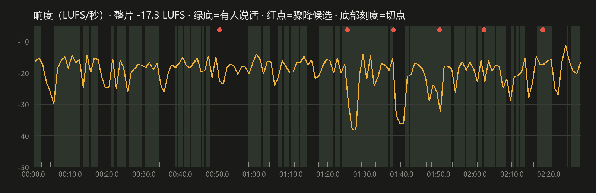

# rea-video · 复刻改编军师

> **Rea = Replicate 复刻 · Examine 拆解 · Adapt 改编**

一个给 AI 编程助手（Claude Code、Codex 等）用的 Agent Skill：丢给它任何一条视频，它会像导演拉片一样把这条视频拆透，再帮你复刻或改编成自己的剧本和视频提示词。

- **拆镜头**：自动找切点，每个镜头截帧拼成联系表，逐镜分析景别、机位、运镜、表演、光影
- **还原剧本**：台词逐句转写到时间轴，标出说话人、语气和语速
- **量剪辑**：平均镜长、节奏曲线、每 10 秒切几刀
- **听配乐**：整片响度、对白下的配乐音量、静音和掐断点
- **找机制**：这条视频凭什么让人看完？钩子、冲突、反转、第二刀、结尾钩子
- **出成品**：拉片报告 / 剧本还原 / 改编剧本 / Seedance 2.5 等视频模型的分段提示词 / 可复用的爆款模板

它来自作者在 Codex 里用了两个多月、拆过五十多条短剧和短视频的一段对话。那段对话里每一次被纠正的地方（"台词没写全""节奏不对""你没看清月饼里夹的是什么"），都写成了这个技能里的硬规则。

## 效果

用作者自己的 AI 短剧《为师修的是无情道》第 1 集（2 分 28 秒，竖屏 4K）实测，工具约 3 分钟跑完：

**联系表**：每镜取中间一帧，标好镜号和时间码


**剪辑节奏**：58 个镜头，平均镜长 2.56 秒，每分钟 23 刀



**响度曲线**：绿底是有人说话的区间，红点是声音突然掉下去的地方（配乐掐断、全场安静）



数据只是第一步。技能会让 AI 对照联系表逐镜填完拉片表，再写出导演级分析，最后按你要的模式出稿。

## 安装

把整个 `rea-video` 文件夹放进你所用工具的 skills 目录：

```bash
# Claude Code
git clone https://github.com/atsicadellianef-hub/rea-video ~/.claude/skills/rea-video

# Codex
git clone https://github.com/atsicadellianef-hub/rea-video ~/.codex/skills/rea-video
```

其他支持 Agent Skills（`SKILL.md`）格式的工具同理。

### 依赖

- [ffmpeg](https://ffmpeg.org/)（含 ffprobe），加入 PATH
- Python 3.9+，`pip install -r requirements.txt`
- 台词转写用 [faster-whisper](https://github.com/SYSTRAN/faster-whisper)，第一次运行会自动下载模型；不装也能跑，只是跳过转写

## 怎么用

装好后直接跟 AI 说：

- "拉片这条视频 `D:/videos/xxx.mp4`"
- "复刻这个视频的剧本，改成我的两个角色：霸总和小助理"
- "学一下这条视频的剪辑和配乐，给我一张配乐表"
- "拆解这条视频，写成 Seedance 2.5 提示词，每段 15 秒以内"
- "这条为什么火？抽成一个以后能套的模板"

也可以单独跑工具：

```bash
python scripts/rea.py all video.mp4 --out work/video --model small
# 台词要求高：--model large-v3；切点太多或太少：--threshold 0.2~0.4
```

输出：`info.json`、`shots.json`、`sheet_*.jpg`、`transcript.srt/json`、`audio.json`、`chart_rhythm.png`、`chart_loudness.png`、`timeline.md`（拉片表骨架）。

## 里面有什么

```
rea-video/
├── SKILL.md                     # 技能主文件：流程、五种输出、复刻改编硬规则
├── scripts/rea.py               # 拉片工具：体检、切点、联系表、转写、响度、图表、拉片表
└── references/
    ├── 01_拉片表.md              # 拉片表每一列怎么填
    ├── 02_导演级拆解清单.md       # 故事机制、镜头语法、表演、光影、剪辑声音
    ├── 03_复刻与改编.md          # 剧本还原格式、换皮四步、竖改横、扩写压缩
    ├── 04_视频提示词.md          # Seedance 2.5 等模型的分段提示词骨架
    └── 05_剪辑与配乐.md          # 节奏和配乐数据怎么读
```

## 几条硬规则

- 先看再写，不凭标题猜内容；看不清、听不清就标出来
- "完美复刻"要逐句、逐拍对齐原片，不能只概括
- 镜头按原片真实切点排；台词按每秒 4–5 个字安排
- 生成提示词默认不引用原视频、无字幕、无背景音乐
- 改编时只保留机制，人物、事件、台词全部换掉

## 版权说明

逐句复刻是用来学习拉片的。要发布的作品请用改编模式，只借鉴结构和机制，不要搬运原作的台词、角色和独特设定。下载和使用他人视频请遵守平台规则和当地法律。

## License

MIT

作者：碎碎白冰 · X [@Cyrusmax519](https://x.com/Cyrusmax519)
